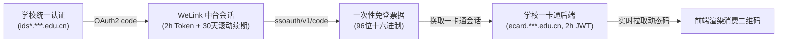

````markdown
# 出示一张校园卡消费码，WeLink 到底干了什么？


每次在食堂排队，打开手机里的 WeLink 再点进校园卡小程序亮码，步骤多不说，一到饭点还经常转半天圈。之前听同学说“桌面端就不卡，只是手机 App 的问题”，恰好之前探测过 WeLink 桌面端——本质上就是一个套着 Electron 的大号浏览器，登录也是走学校统一身份认证。那我干脆顺着桌面端一路拆下去，看看 **出示校园卡消费码这件事，WeLink 到底干了什么**。


---


## 一路摸下来的三个关键发现


### 1. 登录与取票：WeLink 只做身份中转，临时票严格一次性


桌面端登录时，会弹出一个内置网页打开学校的统一身份认证（`ids*.***.edu.cn`，OAuth2 + CAS）。登录成功回调后，原生模块把授权码（连同经过 RSA 加密的租户标识）发往中台 `.../LoginPReg`，换回一套会话：
- 一个 **2 小时有效** 的中台会话 Token；
- 一个 **30 天有效**、且每次刷新都会滚动重置的 `refresh_token`。


而在小程序里最核心的 `HWH5.getAuthCode()`，其实也不是客户端本地算出来的，而是向中台 `.../ssoauth/v1/code` 现要的一张 **96 位十六进制临时票据**。更关键的是，我实测把同一张票重放第二次时，后端直接返回“授权 code 已被使用”——**它是一张严格一次性的票**。


### 2. 桌面端为什么看不到校园卡？只是被设备参数过滤了


起初我也纳闷：既然桌面端和移动端账号互通，为什么桌面端工作台里找不到校园卡和消费码？


翻了桌面端工作台的前端代码才发现，PC 端拉应用列表和搜索应用时，请求体里固定带着一个设备类型参数（PC 端与移动端传值不同）。服务端大概率直接按这个字段把“仅限手机展示”的应用过滤掉了。把请求里的设备参数换成移动端的值，**校园卡和消费码两个离线小程序包就直接在列表里冒出来了**。


### 3. 真正出码的不是 WeLink，而是学校一卡通后端


把离线小程序包下载下来翻了一遍前端逻辑，整条链路的真相就彻底清楚了：
- WeLink 本身**既不生成二维码，也不保存任何一卡通数据**；
- 小程序拿到一次性票据后，直接拿它去请求学校自己的一卡通后端（`ecard.***.edu.cn`），换回一个 **2 小时有效** 的一卡通 JWT 会话；
- 接着再带上这个一卡通会话，去拉取动态消费二维码文本，并在前端画成二维码。


---


## 一图看懂整条链路





---


## 12:46 午饭高峰实测：饭点到底卡在哪？


为了验证到底是不是学校一卡通后端在饭点扛不住，我在 **12:46 午饭高峰时段** 用脚本跑了一遍纯接口直连测速：


- 取一次性免登票据：`~160 ms`
- 换取一卡通 2 小时 JWT：`~260 ms`
- 拉取动态消费二维码：`~160 ms`


**整条冷链路加起来不到 0.6 秒。** 如果复用 2 小时内还没过期的一卡通 JWT，甚至完全不用经过 WeLink，**单次出码只要 ~160 ms**。


所以饭点卡顿的锅，真不全在一卡通后端。真正拖慢体验的是三件事叠加：
1. **手机 App 冷启动和容器初始化太重**；
2. **小程序每次打开都会无条件重走一遍完整鉴权**（源码里明明存了本地会话和校验接口，却还是在页面挂载时直接重新要票换 Token）；
3. **二维码依赖在线动态下发**，没做纯本地离线算码。


---


## 收尾与后续打算


至此，“WeLink 到底干了什么”算是彻底摸透了：只要 30 天内用过一次，靠 `refresh_token` 就能静默滚动续期，日常 2 小时内更是 160 ms 直接拿码，完全不需要每次都打开笨重的客户端。后续我准备把这套机制整理进自己用的第三方学生向校园助手里（纯本地直连 + 安全存储凭据 + 自动续期），以后吃饭终于可以少点好几下屏幕了。


> *注：本文仅以本人账号做个人技术研究与学习记录，文中涉及的学校域名、租户与客户端标识等敏感信息均已做打码处理。*
````
